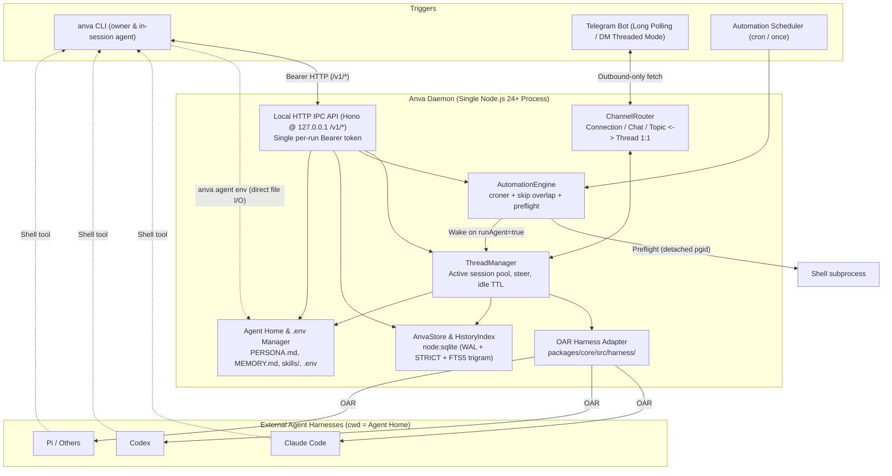

# Anva Architecture

## Design principles and scope

Anva is a local daemon that turns installed coding CLIs (Claude Code, Codex, Pi, and others via [`@botiverse/oar`](https://github.com/botiverse/oar)) into always-on personal agents.

1. **Delegate the harness**: External harnesses (Claude Code, Codex, Pi, and others supported by OAR) own the agent loop, model auth and subscriptions, tool execution, and native skill discovery. All `@botiverse/oar` imports stay behind a single adapter boundary (`packages/core/src/harness/`).
2. **Threads and files first**: Threads are persistent conversations that pin their `harness` at creation and always execute with `cwd` fixed to the agent's home directory (`~/.anva/agents/<slug>/`). Agent state and secrets stay transparent on disk (`PERSONA.md`, `MEMORY.md`, `skills/`, `.env`).
3. **Headless and composable**: Configuration and agent self-management run through the `anva` CLI, local files, and script-first automations. Built-in messaging adapters are outbound-only so no public inbound endpoint is required.
4. **Minimal concepts and fail-fast semantics**: Single-process Node.js daemon (`>=24.0.0`) backed by built-in `node:sqlite`, Hono, Zod, `citty`, and `croner`. No persistent inbox queues, no cross-harness thread switching, and no silent session recreation when resuming a native session fails.

### Explicit non-goals (current version)

- Built-in Web UI or custom terminal TUI.
- Interactive mid-turn tool approval proxy (sessions open in unattended execution mode; harness-level safety remains owned by each external harness).
- IM group chats (Telegram channel targets direct messages and DM Threaded Mode topics).
- Global config files (`config.yaml` / `config.json`), global `.env`, or external custom `cwd` workspaces.

---

## System overview



### Code entry points

| Responsibility                                        | Location                                                                                                     |
| ----------------------------------------------------- | ------------------------------------------------------------------------------------------------------------ |
| OAR single-point adapter                              | [packages/core/src/harness/oar-adapter.ts](../packages/core/src/harness/oar-adapter.ts)                      |
| Agent home provisioning and `.env` management         | [packages/core/src/home/](../packages/core/src/home/)                                                        |
| SQLite store and incremental migrations               | [packages/core/src/store/](../packages/core/src/store/)                                                      |
| Thread runtime, prompt snapshot, FTS5 search, cron    | [packages/core/src/runtime/](../packages/core/src/runtime/)                                                  |
| Local `/v1/*` Hono API and daemon lifecycle           | [packages/core/src/api/server.ts](../packages/core/src/api/server.ts), [app.ts](../packages/core/src/app.ts) |
| Telegram long polling, message delivery, routing      | [packages/channels/src/](../packages/channels/src/)                                                          |
| Unified `anva` CLI (`citty` commands + runtime scope) | [apps/cli/src/](../apps/cli/src/)                                                                            |

---

## Filesystem layout and per-agent `.env`

Root state lives under `~/.anva/` (override with `ANVA_HOME`):

```text
~/.anva/
├── runtime.json                  # Daemon runtime info { pid, url, token } (0600, removed on clean exit)
├── anva.db                       # SQLite database (WAL + STRICT + FTS5)
├── logs/                         # Log directory
└── agents/
    └── <slug>/                   # Agent home directory (fixed cwd for all threads and scripts)
        ├── .gitignore            # Ignores .env and attachments/
        ├── .env                  # Per-agent secrets and channel tokens (0600)
        ├── attachments/          # Inbound channel files
        ├── PERSONA.md            # Agent role and persona (snapshot on session open)
        ├── MEMORY.md             # Long-term memory (snapshot on session open; agent-editable on disk)
        ├── skills/               # Canonical Agent Skills directory (<skill>/SKILL.md)
        ├── .agents/skills -> ../skills
        └── .claude/skills -> ../skills
```

### Environment rules

1. **Resolution precedence** (later overrides earlier): `host process env` -> `~/.anva/agents/<slug>/.env` -> Anva runtime variables (`ANVA_API`, `ANVA_TOKEN`, `ANVA_AGENT_SLUG`, `ANVA_THREAD_ID`).
2. **Reserved variables blocked in `.env`**: `PATH`, `HOME`, `USER`, `LOGNAME`, `SHELL`, `PWD`, `OLDPWD`, `TMPDIR`, `TMP`, `TEMP`, `LANG`, `TERM`, `TZ`, `IFS`, `BASH_ENV`, `ENV`, `NODE_OPTIONS`, `NODE_PATH`, and prefixes `LC_`, `DYLD_`, `LD_`, `ANVA_`.
3. **Secret isolation**: `.env` is parsed via Node's built-in `util.parseEnv`, written atomically with mode `0600`, and edited locally by `anva agent env` without passing secret values over HTTP. The system prompt includes only configured variable **names**, never values.
4. **Harnesses refusing custom `env`**: When a harness declares `refusedSessionOptions` including `env` (`noEnv`), the prompt builder adds inline `ANVA_*` prefix instructions so in-session CLI invocations still resolve daemon scope.

---

## SQLite data model and migrations

`AnvaStore` uses Node's built-in `node:sqlite` (`DatabaseSync`) with WAL journaling, foreign keys enabled, `STRICT` tables, and ordered transactional migrations tracked in `schema_migrations` (`SCHEMA_VERSION = 5`). Opening a database created by a newer Anva schema version fails fast with `db_schema_newer`.

| Migration | Tables / virtual tables created                                                        | Purpose                                                             |
| --------- | -------------------------------------------------------------------------------------- | ------------------------------------------------------------------- |
| `v1`      | `agents`, `threads`, `messages`, `messages_fts` (`tokenize='trigram'`) + sync triggers | Agent registry, immutable-harness threads, message log, FTS5 index  |
| `v2`      | `channel_connections`, `channel_routes`                                                | Telegram bot connections and 1:1 chat/topic-to-thread route mapping |
| `v3`      | `automations`, `automation_runs`                                                       | Scheduled/one-shot automations, cursors, and execution run history  |
| `v4`      | `automations` (`DROP COLUMN target_kind`)                                              | Derive target mode from `target_thread_id` (`NULL` vs thread ID)    |
| `v5`      | `threads` (`parent_thread_id`, `status`, `last_error`, `turn_seq`, turn timestamps)    | Persisted turn lifecycle status and parent-child thread delegation  |

Full SQL definitions live in [packages/core/src/store/schema.ts](../packages/core/src/store/schema.ts).

---

## Runtime subsystem contracts

### Threads and native sessions

- **Direct replies**: Agents respond with plain assistant text; `ThreadManager` stores the reply in `messages` and returns it directly to `anva ask` or the originating channel adapter.
- **Immutable harness**: `threads.harness` is locked at thread creation (defaulting to `agents.default_harness` unless `--harness` or `/new <harness>` is specified). Switching models via `/model` or `anva ask --model` is validated against the thread's current harness, updates `threads.model`, closes the active handle, and resumes the existing `native_session_id`. Switching harnesses requires creating a new thread.
- **Prompt cache preservation**: `PERSONA.md` and `MEMORY.md` are read once when opening or resuming a harness session rather than mutated on every turn.
- **Active pool, live `steer`, and idle eviction**: `ThreadManager` holds active session handles in memory. New input arriving during an active turn calls `deliver(..., { when: "now" })` to steer the turn. Idle sessions with no in-flight turn are disposed after `ANVA_IDLE_TTL_MS` (default 15 minutes) and rehydrated on demand via `native_session_id` resume. Resume, auth, quota, and process errors propagate explicitly (`Fail-Fast`).
- **Turn status and parent-child delegation**: `threads.status` persists execution state (`idle`, `running`, `completed`, `failed`, `aborted`, `interrupted`), recovering stale `running` threads to `interrupted` on daemon startup. Inside an agent session (`ANVA_THREAD_ID`), `anva ask --async` binds `parent_thread_id` and automatically notifies the parent thread when the child finishes (coalesced in memory if the parent is busy, consumed if `anva thread wait` collects the result first, and auto-delivered to any bound channel route unless `NO_REPLY`).

### History search (`HistoryIndex`)

- `messages_fts` uses SQLite's built-in `trigram` tokenizer for substring search across CJK and Latin text.
- Queries split into quoted phrases and space-separated terms: terms of length `>= 3` run against `messages_fts` across the full history ordered by `bm25(messages_fts)`; shorter terms (`< 3` characters) filter with `instr(lower(content), lower(?)) > 0`, bounded to the latest 20,000 messages for the agent when no FTS term narrows the set.
- `automation` threads are deprioritized in ranking by default (and can be excluded with `--no-include-automation`).
- Results are deduplicated per `thread_id`, returning each matching snippet alongside up to 2 preceding and 2 following context messages. When invoked inside an agent session (`ANVA_THREAD_ID` set), the current thread is excluded by default unless `--thread` is passed.
- `anva thread read` truncates individual messages at 2,000 characters by default unless `--full` is set.

### Channels and automations

Operational details, Telegram fail-closed owner pairing (`TELEGRAM_ALLOWED_USER_IDS` + 10-minute single-use deep link), slash commands, script preflight JSON protocol, POSIX `-pgid` timeout termination, `skip` overlap policy, and `NO_REPLY` suppression are documented in [Channels and automations](channels-and-automations.md).

---

## Local IPC API and security model

- **Loopback HTTP IPC**: Hono server on `@hono/node-server` bound to `127.0.0.1` by default, exposing `/v1/*` JSON endpoints. Every daemon boot generates a random 32-byte hex Bearer token stored in `~/.anva/runtime.json` (`0600`) and verified with `timingSafeEqual`.
- **Boundary validation and errors**: All HTTP inputs are validated with Zod schemas at route boundaries (`packages/core/src/api/server.ts`). Errors return structured JSON `{ error, next }`.
- **Trusted single-owner posture**: External harnesses run unattended in the OS user context with `cwd` set to `~/.anva/agents/<slug>/`. Do not bind `--host` to a public interface or expose the IPC port externally.

---

## Technology stack

- **Runtime & language**: Node.js `>=24.0.0`, ESM TypeScript, pnpm workspace
- **Storage**: `node:sqlite` (WAL, `STRICT`, FTS5 `trigram`)
- **Harness & core libraries**: `@botiverse/oar`, `hono`, `@hono/node-server`, `zod`, `citty`, `croner`
- **Tooling**: `tsrs`, `vite-plus` (`vp` / `oxlint` / `oxfmt` / `vitest`)
